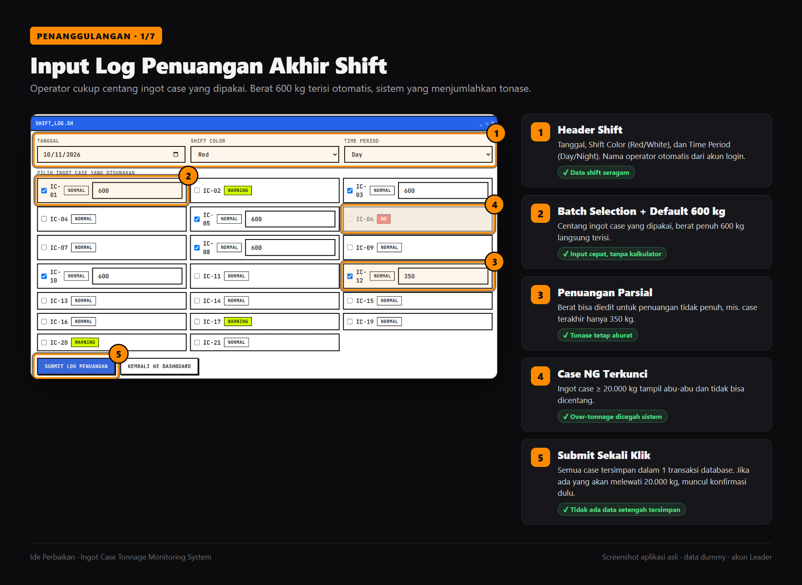
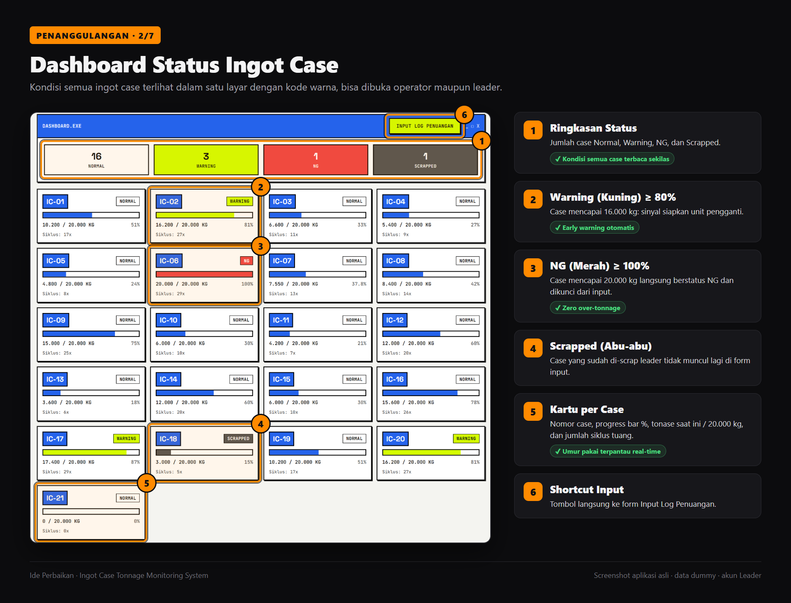
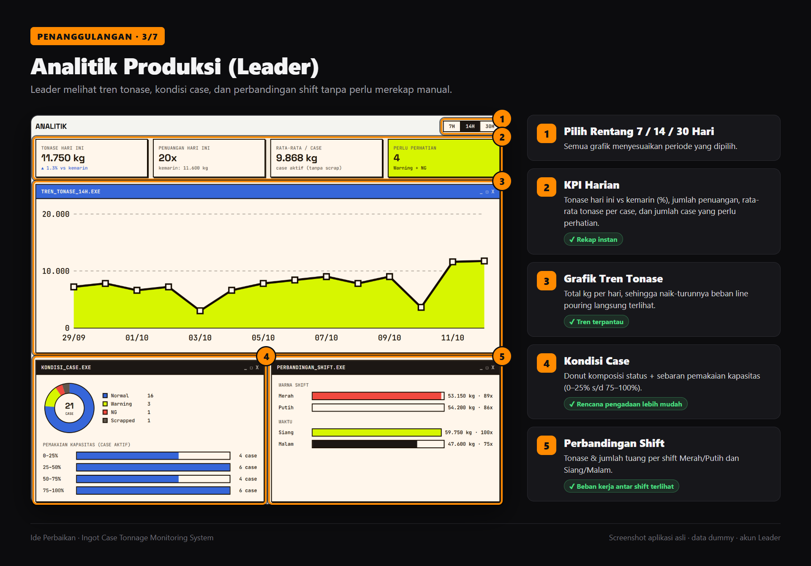
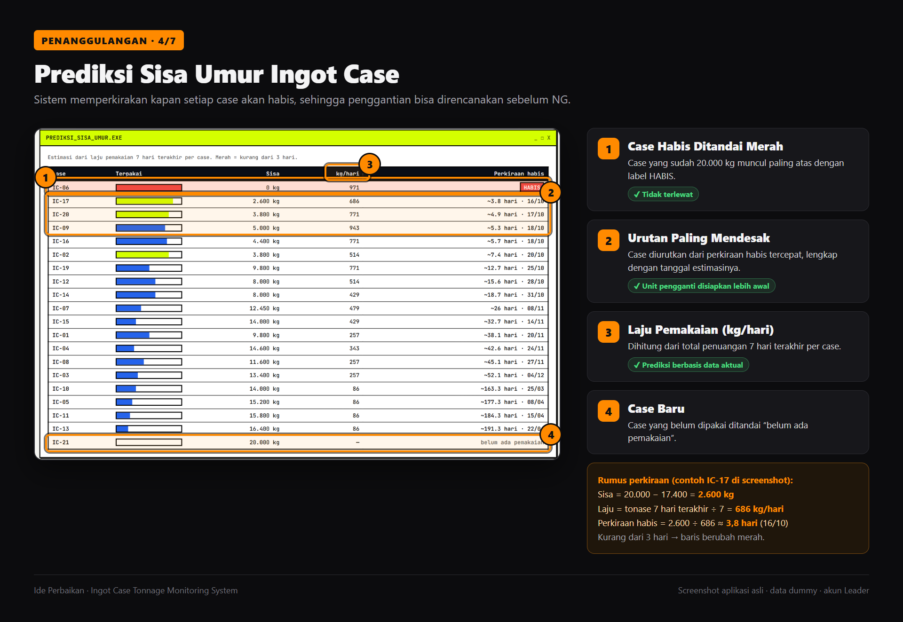
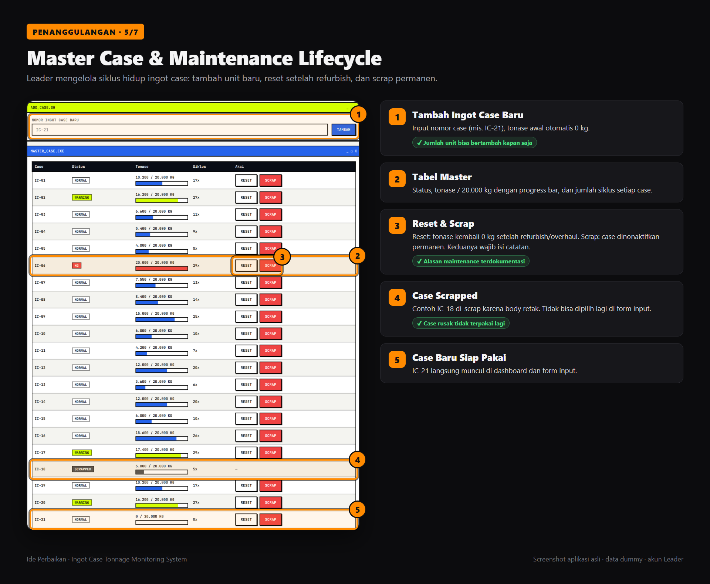
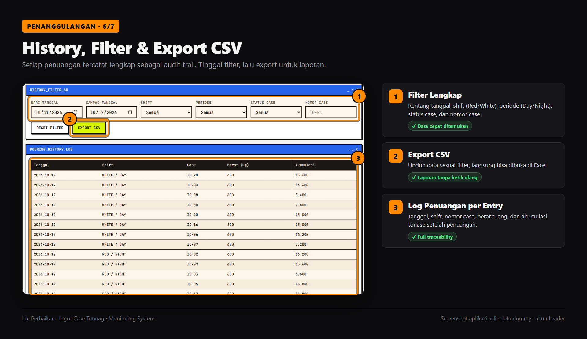
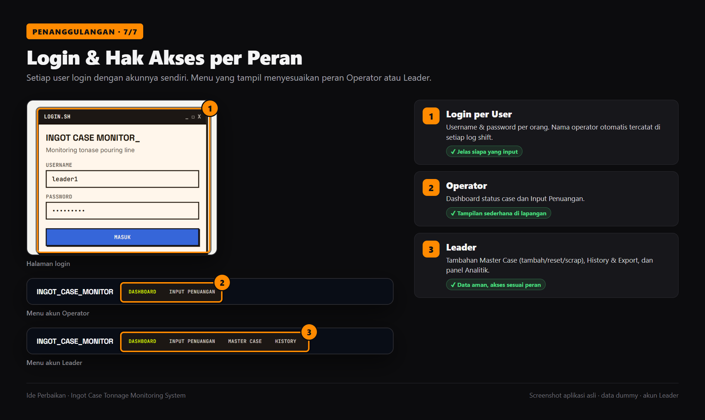
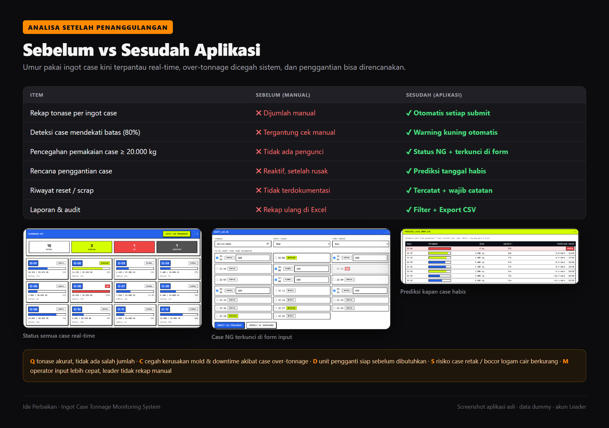

# IDE PERBAIKAN

## Judul

**Digitalisasi Monitoring Tonase Ingot Case: Aplikasi Web untuk Mencatat Penuangan, Memberi Early Warning, dan Mengunci Ingot Case yang Sudah Mencapai Batas Umur Pakai**

---

## 1. Latar Belakang Masalah

Pada *line pouring*, setiap **ingot case** punya batas umur pakai berdasarkan akumulasi beban tonase yang diterimanya:

- Satu kali penuangan penuh = **600 kg**.
- Batas umur pakai ingot case = **20.000 kg** (100%).
- Pada **16.000 kg** (80%), unit pengganti sudah harus disiapkan.
- Jumlah ingot case sekitar **20 unit**, dan rata-rata **±6 unit** dipakai per shift.

Ingot case yang dipakai melebihi 20.000 kg berisiko **retak, bocor cairan logam, merusak mold**, menyebabkan **downtime produksi**, dan membahayakan **keselamatan kerja**.

Selama ini akumulasi tonase dipantau **secara manual**:

- Pemakaian ingot case dicatat per shift, lalu tonasenya dijumlahkan manual.
- Tidak ada tanda otomatis ketika sebuah case mendekati 80% atau sudah 100%.
- Riwayat reset (refurbish/overhaul) dan scrap tidak terdokumentasi dengan rapi.
- Leader merekap ulang data untuk laporan dan untuk menentukan kapan case harus diganti.

Akibatnya, sulit memastikan tidak ada ingot case yang dipakai melewati batas umurnya.

---

## 2. Analisa Masalah

| Aspek | Kondisi Saat Ini | Dampak |
|---|---|---|
| **Man** | Operator dan leader menjumlahkan tonase sendiri setiap shift. Ketelitian tiap orang berbeda. | Akumulasi tonase bisa salah hitung atau terlewat. |
| **Method** | Tidak ada standar pengecekan 80% (warning) dan 100% (NG) sebelum case dipakai. | Case yang sudah mencapai batas bisa tetap dipakai. |
| **Material (Data)** | Data pemakaian tersebar per shift, tanpa riwayat reset/scrap yang rapi. | Sisa umur tiap case sulit diketahui dan audit tidak bisa dilakukan. |
| **Machine (Tools)** | Belum ada alat bantu digital yang menyimpan aturan batas tonase. | Tidak ada pengunci otomatis, dashboard, atau prediksi. |
| **Environment** | Area pouring panas dan sibuk, pencatatan dilakukan di akhir shift saat operator sudah lelah. | Pencatatan terburu-buru, rawan salah atau lupa. |

---

## 3. Detail Masalah

1. **Akumulasi tonase dihitung manual**: setiap penuangan (600 kg atau parsial) harus dijumlahkan ke total case, sehingga rawan selisih.
2. **Tidak ada early warning**: tidak ada tanda saat case mencapai 16.000 kg (80%), jadi unit pengganti sering baru disiapkan setelah case habis.
3. **Tidak ada pengunci NG**: case yang sudah ≥ 20.000 kg tetap bisa terpakai karena tidak ada sistem yang memblokir.
4. **Penuangan parsial sulit dicatat**: case terakhir di shift sering tidak penuh (mis. 350 kg) dan rawan dicatat sebagai 600 kg atau terlewat.
5. **Riwayat maintenance tidak tercatat**: alasan reset (ganti lining, overhaul body) dan scrap tidak terdokumentasi.
6. **Rekap & laporan memakan waktu**: leader harus menyusun ulang data secara manual untuk laporan.
7. **Penggantian bersifat reaktif**: tidak ada perkiraan kapan setiap case akan habis, sehingga pengadaan unit pengganti tidak terencana.

---

## 4. Root Cause (Akar Masalah)

Dianalisa menggunakan metode **5 Why**:

| Why | Jawaban |
|---|---|
| Kenapa ingot case berisiko dipakai melewati 20.000 kg? | Karena status tonase setiap case tidak diketahui secara pasti saat akan dipakai. |
| Kenapa status tonase tidak diketahui pasti? | Karena akumulasi tonase dihitung dan direkap manual per shift. |
| Kenapa dihitung manual? | Karena tidak ada alat yang menyimpan data penuangan dan menjumlahkannya otomatis. |
| Kenapa batas 80% dan 100% tidak dicek? | Karena aturan batas tonase tidak tertanam di alat apa pun, hanya bergantung pada ingatan dan ketelitian orang. |
| Kenapa tidak ada alat tersebut? | **Belum ada sistem digital terpusat untuk mencatat penuangan, menghitung akumulasi tonase, dan mengunci ingot case.** |

**Root cause:** tidak ada sistem digital terstandar. Akibatnya perhitungan akumulasi tonase dan pengecekan batas umur ingot case bergantung pada manusia, dan datanya tidak tersimpan terpusat.

---

## 5. Penanggulangan

Dibuat **Aplikasi Web Ingot Case Tonnage Monitoring System** yang bisa diakses lewat tablet/PC di area produksi, dengan fitur:

| No | Fitur | Mengatasi Masalah |
|---|---|---|
| 1 | **Input Log Penuangan Akhir Shift**: header shift (tanggal, Red/White, Day/Night) dan *batch selection* ingot case. | Pencatatan cepat dan seragam. |
| 2 | **Default 600 kg + Penuangan Parsial**: berat penuh terisi otomatis dan bisa diedit (mis. 350 kg). | Akumulasi tonase akurat tanpa kalkulator. |
| 3 | **Akumulasi Tonase Otomatis**: tersimpan dalam 1 transaksi database, aman walau 2 operator submit bersamaan. | Tidak ada salah jumlah atau data dobel. |
| 4 | **Kode Warna Status**: Normal (< 80%), **Warning kuning** (≥ 16.000 kg), **NG merah** (≥ 20.000 kg), Scrapped. | Early warning otomatis. |
| 5 | **Pengunci NG**: case NG tidak bisa dipilih di form input, dan ada konfirmasi bila penuangan akan melewati 20.000 kg. | **Zero over-tonnage incident.** |
| 6 | **Dashboard Kartu per Case**: progress bar %, tonase / 20.000 kg, dan jumlah siklus. | Sisa umur tiap case terlihat real-time. |
| 7 | **Analitik Leader**: KPI harian, tren tonase 7/14/30 hari, kondisi case, perbandingan shift. | Tidak perlu rekap manual. |
| 8 | **Prediksi Sisa Umur**: perkiraan hari dan tanggal habis per case dari laju 7 hari terakhir. | Penggantian dan pengadaan terencana. |
| 9 | **Master Case**: tambah case baru, **Reset** setelah refurbish, dan **Scrap** permanen, semuanya wajib isi catatan. | Riwayat maintenance terdokumentasi. |
| 10 | **History + Filter + Export CSV**: filter tanggal, shift, periode, status, dan nomor case. | Audit trail lengkap, laporan instan. |
| 11 | **Login & Role Operator / Leader**: operator hanya input dan lihat dashboard, leader mengelola data. | Data aman, akses sesuai peran. |

**Ilustrasi fitur (screenshot aplikasi dengan data dummy, akun Leader):**









**Alur kerja baru:**

```
Operator login → isi header shift → centang ingot case yang dipakai (600 kg / parsial)
        ↓ (otomatis)
Tonase tiap case bertambah → status Normal / Warning / NG diperbarui
        ↓
Case NG terkunci, tidak bisa dipakai lagi
        ↓
Leader pantau Dashboard + Prediksi → siapkan pengganti → Reset / Scrap + catatan
        ↓
History + Export CSV untuk laporan & audit
```

---

## 6. Analisa Setelah Penanggulangan

| Item | Sebelum | Sesudah |
|---|---|---|
| Rekap tonase per ingot case | Dijumlah manual | **Otomatis setiap submit** |
| Deteksi case mendekati batas (80%) | Tergantung cek manual | **Warning kuning otomatis** |
| Pencegahan pemakaian case ≥ 20.000 kg | Tidak ada pengunci | **Status NG + terkunci di form** |
| Rencana penggantian case | Reaktif, setelah rusak | **Prediksi tanggal habis** |
| Riwayat reset / scrap | Tidak terdokumentasi | **Tercatat + wajib catatan** |
| Laporan & audit | Rekap ulang di Excel | **Filter + Export CSV** |



**Efek tidak langsung (Q-C-D-S-M):**

- **Quality**: data tonase akurat, sehingga umur pakai ingot case sesuai standar.
- **Cost**: mencegah kerusakan mold dan downtime akibat ingot case over-tonnage.
- **Delivery**: unit pengganti sudah siap sebelum dibutuhkan, sehingga produksi tidak tertunda.
- **Safety**: risiko ingot case retak atau bocor cairan logam berkurang.
- **Morale**: operator input lebih cepat, leader tidak perlu rekap manual.

**Rencana lanjutan (standarisasi):**

1. Sosialisasi dan training operator, lalu jadikan aplikasi ini standar pencatatan penuangan resmi.
2. Evaluasi 1 bulan: pantau jumlah case NG yang terkunci, insiden over-tonnage, dan ketepatan prediksi sisa umur.
3. Pengembangan berikutnya: integrasi otomatis dengan load cell / PLC / RFID (endpoint API sudah disiapkan), sehingga operator tidak perlu input manual lagi.
